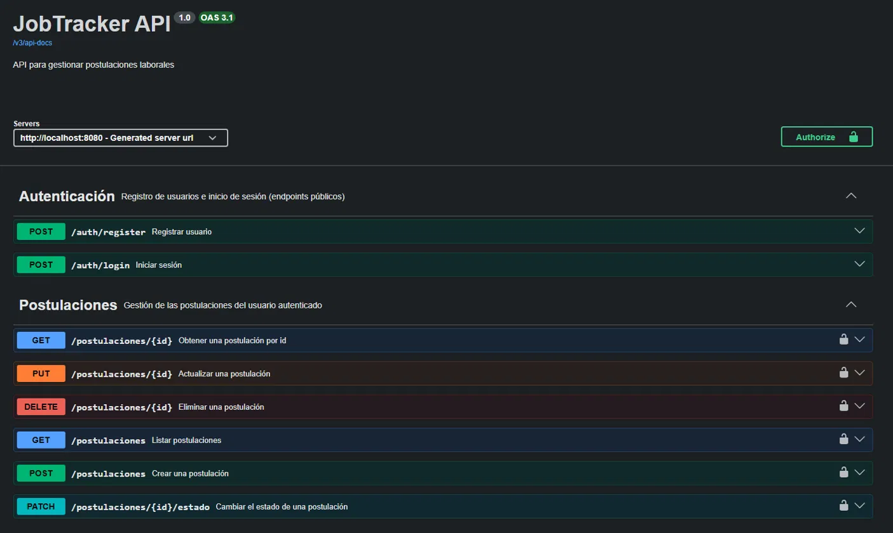
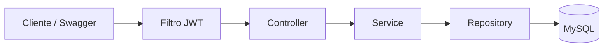

# JobTracker API


API REST para **gestionar las postulaciones laborales** de cada usuario: registrar a qué puestos te postulaste, en qué estado está cada proceso y buscar o filtrar tu historial. Cada usuario ve y modifica únicamente sus propias postulaciones.

Es un proyecto personal para practicar un backend completo con Java y Spring Boot: autenticación, seguridad, tests, contenedores y CI.



## Funcionalidades

- Registro e inicio de sesión de usuarios con **JWT**.
- CRUD de postulaciones: puesto, empresa, link de la oferta, notas, seniority, fecha y estado.
- Estados del proceso: `ENVIADA`, `ENTREVISTA`, `RECHAZADA`, `OFERTA` (la empresa te hizo una oferta en ese proceso).
- Listado **paginado**, con filtro por estado y búsqueda por texto (en el puesto o en la empresa).
- **Aislamiento por usuario**: nadie puede ver, editar ni borrar postulaciones ajenas.
- Empresas compartidas entre usuarios: si la empresa no existe, se crea automáticamente (sin distinguir mayúsculas).
- Manejo global de errores con respuestas claras (`400`, `401`, `404`, `409`).
- Documentación interactiva con **Swagger / OpenAPI**.

## Tecnologías

| Área | Herramientas                                   |
|---|------------------------------------------------|
| Lenguaje y framework | Java 21, Spring Boot 4, Maven                  |
| Persistencia | Spring Data JPA (Hibernate), MySQL 8.4, Flyway |
| Seguridad | Spring Security, JWT (jjwt), BCrypt            |
| Documentación | springdoc-openapi (Swagger UI)                 |
| Testing | JUnit 5, Mockito, Testcontainers               |
| Infraestructura | Docker, Docker Compose, GitHub Actions (CI)    |

## Arquitectura

Arquitectura en capas dentro de un único proyecto (monolito), con DTOs para separar lo que expone la API de lo que se guarda en la base.



```
src/main/java/jobtracker
├── config        # Seguridad y OpenAPI
├── controller    # Endpoints REST
├── dto           # Objetos de entrada y salida de la API
├── entity        # Entidades JPA y enums
├── exception     # Excepciones propias y manejo global de errores
├── repository    # Acceso a datos (Spring Data JPA)
├── security      # Filtro de autenticación JWT
└── service       # Lógica de negocio
```

## Cómo ejecutarlo

### Con Docker (recomendado)

Requisitos: [Docker Desktop](https://www.docker.com/products/docker-desktop/) instalado y en ejecución.

```bash
# 1. Clonar el repositorio
git clone https://github.com/alexisrodriguezar/jobtracker.git
cd jobtracker

# 2. Crear el archivo de variables de entorno
cp .env.example .env
# Abrí el archivo .env y completá tus propias contraseñas y el JWT_SECRET

# 3. Levantar la aplicación y la base de datos
docker compose up --build
```

La aplicación queda disponible en `http://localhost:8080`, con la documentación en:

**http://localhost:8080/swagger-ui/index.html**

La base MySQL también queda expuesta en el puerto `3307` de tu máquina, por si querés explorarla con un cliente como Workbench.

Para apagar todo: `docker compose down` (conserva los datos) o `docker compose down -v` (los borra).

### Sin Docker

Requisitos: Java 21 y un MySQL local.

1. Definí las variables de entorno `DB_USER`, `DB_PASSWORD` y `JWT_SECRET` (mínimo 32 caracteres).
2. Ejecutá:

```bash
./mvnw spring-boot:run
```
## Problemas frecuentes

- **`Access denied for user 'jobtracker'` al levantar con Docker**: MySQL guarda las credenciales la primera vez que crea la base. Si cambiaste las contraseñas del `.env` después de haber levantado el proyecto, ejecutá `docker compose down -v` (borra la base de Docker) y volvé a levantar.
- **`port is already allocated`**: hay otro programa usando el puerto 8080 o 3307 (por ejemplo, la app corriendo desde el IDE).

## Uso rápido

1. Registrá un usuario con `POST /auth/register`.
2. Iniciá sesión con `POST /auth/login` y copiá el token de la respuesta.
3. En Swagger, botón **Authorize**, pegá el token. Desde ahí podés probar todos los endpoints.

Ejemplo, crear una postulación (`POST /postulaciones`):

```json
{
  "empresa": "EY",
  "puesto": "Backend Developer Jr",
  "link": "https://ejemplo.com/oferta",
  "nota": "Entrevista técnica pendiente",
  "seniority": "JUNIOR"
}
```

Respuesta (`201 Created`):

```json
{
  "id": 1,
  "empresa": "EY",
  "puesto": "Backend Developer Jr",
  "estado": "ENVIADA",
  "seniority": "JUNIOR",
  "link": "https://ejemplo.com/oferta",
  "nota": "Entrevista técnica pendiente",
  "fechaPostulacion": "2026-10-27"
}
```

## Endpoints

| Método | Ruta | Descripción | Auth |
|---|---|---|---|
| POST | `/auth/register` | Registrar un usuario | No |
| POST | `/auth/login` | Iniciar sesión y obtener el token | No |
| POST | `/postulaciones` | Crear una postulación (estado inicial `ENVIADA`) | Sí |
| GET | `/postulaciones` | Listar las propias, con filtros y paginación | Sí |
| GET | `/postulaciones/{id}` | Obtener una postulación | Sí |
| PUT | `/postulaciones/{id}` | Actualizar los datos de una postulación | Sí |
| PATCH | `/postulaciones/{id}/estado` | Cambiar el estado | Sí |
| DELETE | `/postulaciones/{id}` | Eliminar una postulación | Sí |

Parámetros opcionales del listado: `estado`, `buscar`, `page`, `size` y `sort`.
Ejemplo: `GET /postulaciones?estado=ENTREVISTA&buscar=backend&page=0&size=10`

## Tests

```bash
./mvnw test
```

- **Unitarios** (JUnit 5 y Mockito): cubren la lógica de los services, incluyendo los casos de seguridad (un usuario intentando acceder a datos de otro).
- **De integración** (Testcontainers): prueban los repositories contra un MySQL real que se levanta en un contenedor, verificando consultas, filtros, paginación y restricciones de la base.

Los tests de integración necesitan Docker en ejecución. Todo el conjunto corre automáticamente en cada Pull Request mediante GitHub Actions.

## Decisiones de diseño

- **JWT sin sesiones**: el servidor no guarda estado; el usuario se obtiene del token en cada request, nunca de un dato enviado por el cliente.
- **`404` en lugar de `403`** cuando una postulación es de otro usuario, para no revelar que existe.
- **Mismo mensaje de error** para email inexistente y contraseña incorrecta, para no permitir descubrir qué correos están registrados.
- **Contraseñas con BCrypt**: nunca se guardan ni se devuelven en texto plano.
- **DTOs separados** para entrada y salida, para no exponer las entidades.
- **Esquema versionado con Flyway**: cada cambio de la base es un archivo SQL numerado y revisable en un Pull Request; Hibernate solo valida que las entidades coincidan con el esquema.

## Próximos pasos

- [x] Migraciones de base de datos con Flyway.
- [ ] Análisis de ofertas con IA: comparar una oferta con el perfil del usuario.
- [ ] Deploy con URL pública.
- [ ] Frontend con React.

## Autor

**Alexis Rodriguez**: Estudiante de Ingeniería en Sistemas de Información (UTN), orientado al desarrollo backend con Java.

- LinkedIn: [Alexis Rodriguez](https://www.linkedin.com/in/alexisrodriguezar/)
- GitHub: [@alexisrodriguezar](https://github.com/alexisrodriguezar)
